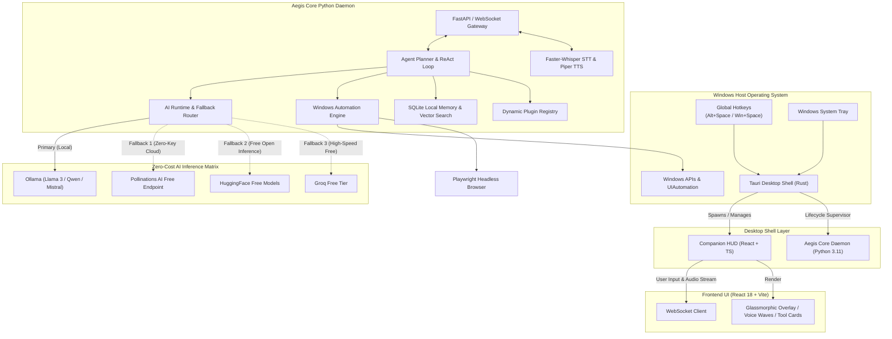
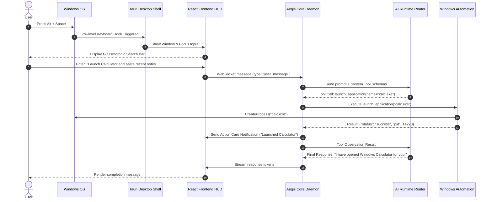

# Aegis AI — System Architecture Specification

This document provides a comprehensive technical breakdown of **Aegis AI**, an open-source, local-first Windows AI companion.

---

## 1. High-Level System Architecture

Aegis AI is structured as a decoupled three-tier system designed for ultra-low latency, native operating system integration, and zero mandatory cloud dependencies.



---

## 2. Core Architectural Subsystems

### 2.1 Tauri Desktop Shell (Host Layer)
- **Role**: Native Windows entrypoint, global keyboard hook listener, and transparent window orchestrator.
- **Process Management**: Supervises the background Python daemon lifecycle (`aegis-core`), guaranteeing clean process termination without zombie processes.
- **Window Capabilities**:
  - Borderless, frameless transparent overlay with glassmorphism (Windows 11 Mica / Acrylic effect).
  - Multi-monitor coordinate detection, centering the HUD on the currently focused display.
  - Global hotkeys (`Alt + Space`, `Win + Space`, or custom keys) registered via Windows low-level keyboard hooks.
  - Native system tray integration with quick actions (mute, switch model, open settings, quit).

### 2.2 Frontend HUD (Presentation Layer)
- **Technology**: React 18, TypeScript, Vite, TailwindCSS, Lucide-React.
- **Key Responsibilities**:
  - Sub-millisecond response to hotkey summon.
  - Bidirectional WebSocket streaming for tokens, system status, and voice waveforms.
  - Interactive Action Cards: Visual confirmation cards whenever the AI suggests mutating actions (e.g., closing an application, deleting a file).
  - Voice Activity Visualizer: Real-time audio waveform animation during STT capture and TTS playback.

### 2.3 Aegis Core Daemon (Intelligence & Automation Layer)
- **Technology**: Python 3.11+, FastAPI, Uvicorn, AsyncIO.
- **Components**:
  1. **AI Runtime Router (`ai_runtime`)**:
     - Evaluates local Ollama instance availability (`http://localhost:11434/api/tags`).
     - Auto-discovers installed models (`llama3.2`, `qwen2.5`, `mistral`, `phi3`).
     - Fallback chain: If Ollama is offline or uninstalled, seamlessly redirects prompt execution to free open inference APIs without interrupting the conversation.
  2. **Agent Planner & Reasoning Loop (`agent`)**:
     - Implements an asynchronous ReAct (Reason + Act) loop.
     - Formats prompts, invokes registered tools, validates outputs, and feeds observations back to the LLM.
     - Self-correction mechanism: If a tool fails with an error code, the agent analyzes the stack trace and re-plans alternative steps.
  3. **Windows Automation Subsystem (`automation`)**:
     - **Process Controller**: Enumerates running tasks, launches executables via Windows Shell, terminates processes safely.
     - **Window Controller**: Finds window handles (`HWND`), brings windows to focus, minimizes, maximizes, and tiles applications.
     - **Clipboard Controller**: Thread-safe Windows clipboard inspection and updates.
     - **Browser Controller**: Playwright integration for Chromium navigation, form completion, and DOM data extraction.
  4. **Local Memory & Database (`memory`)**:
     - SQLite database with Write-Ahead Logging (`WAL` mode) for maximum concurrent read/write throughput.
     - Stores session threads, structured message histories, tool execution logs, and system preferences.
     - Context Window Manager: Truncates and summarizes long conversational histories to fit within local model context windows (e.g. 4k / 8k / 16k tokens).
  5. **Voice Pipeline (`voice`)**:
     - **STT (Speech-to-Text)**: Faster-Whisper running on CPU (INT8 quantization) or CUDA (FP16), converting user voice into text in near real-time.
     - **TTS (Text-to-Speech)**: Piper TTS neural synthesis, generating high-clarity natural speech with zero external latency.
  6. **Dynamic Plugin Registry (`plugins`)**:
     - Standardized `BaseTool` specification.
     - Automatic discovery of Python plugin scripts located in `plugins/` directory.
     - Safety categorization: `READ_ONLY`, `MUTATING_SAFE`, and `RESTRICTED_CONFIRM`.

---

## 3. Interaction Sequence: Summoning & Windows Automation



---

## 4. Zero API Keys & Autonomous Fallback Strategy

Aegis AI enforces an uncompromising **Zero API Keys Assumption**:

| Priority | Provider | Protocol | Cost | Authentication |
| :--- | :--- | :--- | :--- | :--- |
| **1 (Default)** | **Ollama** | Local REST (`http://localhost:11434`) | Free / Local | None |
| **2 (Fallback)** | **Pollinations AI** | Public REST (`https://text.pollinations.ai/`) | Free | None |
| **3 (Fallback)** | **HuggingFace Public Endpoints** | Public REST | Free Tier | None / Optional |
| **4 (Fallback)** | **Groq Free Tier** | OpenAI-compatible API | Free Tier | Free signup key |
| **5 (Fallback)** | **Local llama.cpp** | Local binary / server | Free / Local | None |

When a query is dispatched, the `AIRuntimeRouter` performs a health probe:
1. Pings `http://localhost:11434/api/tags` with a 500ms timeout.
2. If healthy, requests stream directly from the selected local model.
3. If unreachable or error 503 is returned, the router automatically fails over to the next tier in the matrix and tags the response telemetry with `provider: fallback_pollinations`.
4. The user is notified gracefully via the UI status badge, ensuring zero interrupted conversations.

---

## 5. Security & Isolation Matrix

| Capability | Risk Level | Protection Mechanism |
| :--- | :--- | :--- |
| Read active window title | Low | Safe Win32 `GetWindowText` call. Autonomous execution. |
| Read/write clipboard | Medium | Thread-locked Win32 clipboard API. User visual indicator displayed. |
| Launch whitelisted app | Medium | Process validation against known Windows executables. |
| Terminate process | High | Requires explicit user confirmation card before `TerminateProcess`. |
| Delete file / directory | High | Requires user confirmation; routes to Windows Recycle Bin when possible. |
| Execute arbitrary shell command | Critical | Blocked by default unless "Developer Mode" is unlocked in settings with warning. |

---

## 6. Directory Structure Overview

```
Aegis-AI/
├── .github/                 # Workflows, issue templates, PR template
├── docs/                    # Architecture, milestones, RFCs
├── src-tauri/               # Tauri Rust container, hotkeys, tray, window configuration
├── apps/
│   └── desktop-ui/          # React 18, TypeScript, TailwindCSS HUD
├── backend/
│   ├── aegis_core/          # Core Python daemon package
│   │   ├── main.py          # FastAPI application & WebSocket server
│   │   ├── config.py        # Settings, env management, constants
│   │   ├── api/             # HTTP & WebSocket route handlers
│   │   ├── agent/           # ReAct planner, agent loop, tool executor
│   │   ├── ai_runtime/      # Ollama, Pollinations, free providers
│   │   ├── automation/      # Windows API, UIAutomation, process controller
│   │   ├── memory/          # SQLite database, session models, vector search
│   │   ├── voice/           # Faster-Whisper STT & Piper TTS
│   │   ├── plugins/         # BaseTool interface & dynamic plugin loader
│   │   └── utils/           # Structured logging, Windows telemetry
│   ├── tests/               # Pytest unit & integration test suite
│   ├── requirements.txt     # Python dependencies
│   └── pyproject.toml       # Python project metadata & tool configs
├── scripts/                 # PowerShell dev & launch scripts
├── README.md                # Project landing page
├── ARCHITECTURE.md          # This architectural blueprint
├── ROADMAP.md               # 12-month engineering plan
├── CONTRIBUTING.md           # Developer guidelines
├── SECURITY.md              # Vulnerability reporting & security model
├── CHANGELOG.md             # Semantic version release log
├── CODE_OF_CONDUCT.md       # Contributor Covenant 2.1
└── LICENSE                  # Apache License 2.0
```

