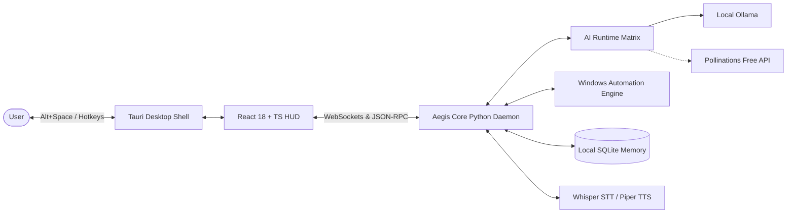

<div align="center">

# 🛡️ Aegis AI

### The Autonomous, Local-First Windows AI Companion

[](LICENSE)
[](https://www.microsoft.com/windows)
[](https://www.python.org/)
[](backend/aegis_core/desktop/window.py)
[](https://react.dev/)
[](https://ollama.com/)
[](#-zero-api-keys-guarantee)

*Aegis AI integrates deeply into Windows as a native, glassmorphic companion overlay summoned by **Alt + Space**. Built with zero mandatory subscriptions, zero required paid API keys, and 100% local privacy by design.*

[Features](#-features) •
[Zero API Keys Guarantee](#-zero-api-keys-guarantee) •
[Architecture](#-architecture) •
[Quickstart](#-quickstart) •
[Roadmap](#-roadmap) •
[Contributing](#-contributing) •
[Documentation](docs/)

</div>

---

## 🌟 Vision

Modern AI assistants trap users behind expensive cloud subscriptions, privacy-invasive servers, and sluggish browser tabs. 

**Aegis AI** changes the paradigm:
- **Feels native to Windows**: Floats over your desktop with a glassmorphic HUD summoned instantly via `Alt + Space` or `Win + Space`.
- **Works completely out-of-the-box**: Defaults to local LLMs via **Ollama** and intelligent zero-cost fallback networks. No credit cards, no billing accounts, no paid API keys required.
- **Deep Windows Operating System Control**: Manages running processes, manipulates windows, controls the clipboard, navigates the web with Playwright, and inspects files.
- **Autonomous Multi-Step Reasoning**: Capable of planning, executing tool chains, self-correcting errors, and summarizing complex documents.
- **Local Speech & Voice Pipeline**: High-speed offline speech recognition via **Faster-Whisper** and neural voice synthesis via **Piper TTS**.

---

## 🔒 Zero API Keys Guarantee

Aegis AI was engineered from day one on the principle of **Zero Mandatory API Keys**:

| Tier | Provider | Model Family | Requirements | Privacy Level |
| :---: | :---: | :---: | :---: | :---: |
| **Primary** | **Ollama** | Llama 3.2, Qwen 2.5, Phi-3, Mistral | Local machine | 100% Air-Gapped Local |
| **Fallback 1** | **Pollinations AI** | Open-source foundation models | Public Internet | Anonymous Free Endpoint |
| **Fallback 2** | **HuggingFace** | Free community models | Public Internet | Free Tier |
| **Fallback 3** | **Groq Free** | Llama 3 70B (free tier) | Free user key (optional) | High-speed cloud |

If your local Ollama instance is not running, Aegis AI automatically shifts to free public inference endpoints without dropping your conversation. Paid APIs (OpenAI, Anthropic, Google Gemini) are supported purely as **optional** integrations.

---

## ⚡ Features

### 🖥️ Desktop Companion Overlay
- **Instant Hotkey Summon**: Press `Alt + Space` (or `Win + Space`) anywhere in Windows to bring up the glassmorphic HUD.
- **System Tray Resident**: Lives quietly in the Windows notification area with minimal resource footprint (~40MB RAM).
- **Responsive Animations**: Designed with glassmorphism, fluid typography, and dark-mode aesthetics tailored for Windows 11.

### 🤖 Windows Desktop Automation
- **Process Orchestration**: Launch, inspect, and safely terminate Windows applications (`notepad.exe`, `calc.exe`, `code`, etc.).
- **Window Management**: Focus, minimize, maximize, and tile active application windows.
- **Clipboard Intelligence**: Read and write clipboard content, extract code snippets, and format text.
- **Keyboard & Mouse Simulation**: Native inputs via Windows Win32 APIs for automating repetitive desktop clicks and form entry.

### 🌐 Web & Browser Automation
- **Headless & Visible Chromium**: Powered by Playwright for reliable web navigation, form submission, and live scraping.
- **Article & Data Extractor**: Extract clean text, tables, and structured data from arbitrary websites.

### 🎙️ Offline Voice Intelligence
- **Faster-Whisper STT**: Real-time offline speech-to-text with INT8 / FP16 hardware acceleration.
- **Piper Neural TTS**: High-fidelity, local neural speech synthesis with zero cloud latency.
- **Audio Waveform HUD**: Visual indicator that pulses in real time to speech input and output.

### 🧠 Persistent Local Memory
- **SQLite Database with WAL Mode**: Stores all conversation history, sessions, user preferences, and tool logs locally.
- **Context Management**: Automatic conversation summarization and sliding-window pruning.
- **Local Document RAG**: Vector-indexed retrieval across PDFs, markdown, and office documents.

### 🧩 Dynamic Plugin Ecosystem
- **Extensible Python Tool System**: Drop custom Python tools into `plugins/` to teach Aegis AI new tricks.
- **Safety Boundaries**: Three-tiered permission guardrails (`READ_ONLY`, `MUTATING_SAFE`, `RESTRICTED_CONFIRM`).

---

## 🏛️ Architecture

Aegis AI adopts a decoupled, event-driven architecture combining a native Rust desktop container, a React/TypeScript HUD, and a Python core daemon:



For complete technical specifications, see [ARCHITECTURE.md](ARCHITECTURE.md).

---

## 🚀 Quickstart

### Prerequisites
- **Windows 10 / 11** (64-bit)
- **Python 3.11+** installed and added to PATH ([python.org](https://www.python.org/downloads/))
- **Node.js 20+** ([nodejs.org](https://nodejs.org/))
- **Ollama** (Recommended for local offline intelligence):
  ```powershell
  # Download and install Ollama from https://ollama.com
  # Then pull a fast, capable local model:
  ollama run llama3.2
  ```

### 1. Clone the Repository
```powershell
git clone git@github.com:mokashreef/Aegis-AI.git
cd "Aegis AI"
```

### 2. Setup & Install Dependencies
```powershell
# Run the automated setup script
.\scripts\setup_env.ps1
```

### 3. Launch Aegis AI Desktop Companion
```powershell
# One-click launcher (starts native overlay & registers Alt+Space)
.\scripts\run_desktop.ps1

# Or run directly via Python:
python aegis.py
```
Press **`Alt + Space`** anywhere in Windows to summon or dismiss the companion! Press **`ESC`** to close instantly.

---

## 🗺️ Roadmap

- **Q1 (MVP)**: Local Core Daemon, Ollama & Pollinations fallback, SQLite memory, React HUD, process launching.
- **Q2**: UIAutomation controls, local screenshot vision (LLaVA/Moondream), local document vector search (RAG).
- **Q3**: Autonomous ReAct agent workflows, Playwright browser engine, offline wake-word ("Hey Aegis").
- **Q4**: Community plugin store, peer-to-peer encrypted sync, MSIX/Winget one-click Windows installer.

Read the full 12-month engineering plan in [ROADMAP.md](ROADMAP.md).

---

## 🤝 Contributing

We welcome contributions from engineers, designers, and AI researchers worldwide! 
Please review our [Contributing Guidelines](CONTRIBUTING.md) and [Code of Conduct](CODE_OF_CONDUCT.md).

To get started:
1. Browse open [Good First Issues](https://github.com/mokashreef/Aegis-AI/labels/good%20first%20issue).
2. Read the architectural guidelines in [ARCHITECTURE.md](ARCHITECTURE.md).
3. Submit a Pull Request following our [PR Template](.github/PULL_REQUEST_TEMPLATE.md).

---

## 📄 License

Aegis AI is open-source software licensed under the **[Apache License, Version 2.0](LICENSE)**.
You are free to use, modify, distribute, and integrate this software in commercial or personal projects under the terms of the Apache 2.0 license.

---

<div align="center">
  <sub>Built with pride for the global open-source community. Aegis AI is maintained by Mokashreef and contributors.</sub>
</div>

