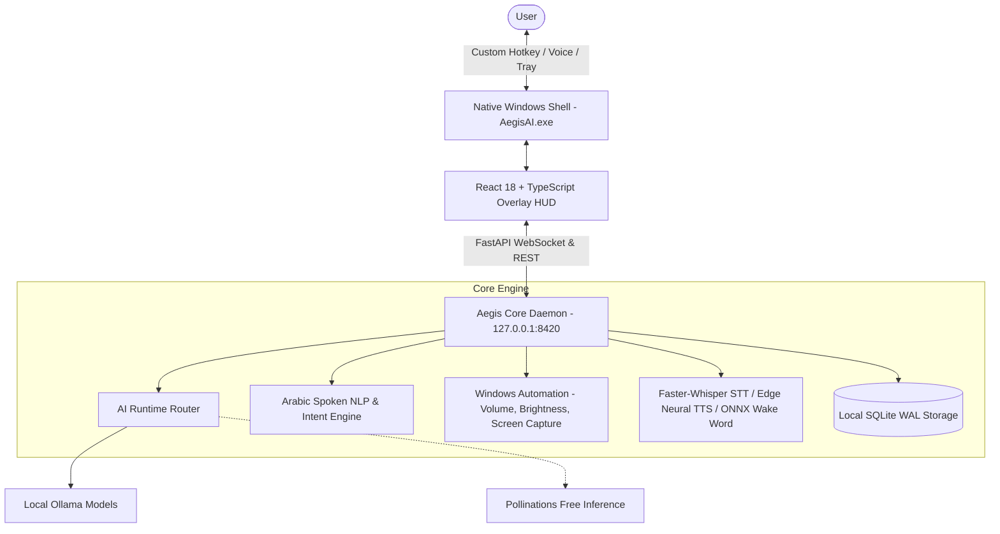

<div align="center">

# 🛡️ Aegis AI

### The Autonomous, Local-First Windows AI Companion & Desktop Copilot

[](LICENSE)
[](https://www.microsoft.com/windows)
[](https://github.com/mokashreef/Aegis-AI/releases/latest)
[](https://github.com/mokashreef/Aegis-AI/actions)
[](https://www.python.org/)
[](backend/aegis_core/desktop/window.py)
[](https://react.dev/)
[](https://ollama.com/)
[](#-zero-api-keys-guarantee)

<br />

**Aegis AI** is a native, privacy-first desktop companion for Windows 10/11.  
Summoned instantly via a customizable global hotkey (default **`Alt + Space`**), Aegis AI operates with **zero mandatory subscriptions**, **zero required paid API keys**, and **100% local privacy**.

<br />

[📥 **Download Latest Release**](#-download--installation) •
[⚡ **Key Features**](#-key-features) •
[🔒 **Zero API Keys Guarantee**](#-zero-api-keys-guarantee) •
[🏛️ **Architecture**](#-architecture) •
[🚀 **Quickstart**](#-quickstart) •
[🇸🇦 **الدليل بالعربية**](#-دليل-التشغيل-السريع-باللغة-العربية) •
[🗺️ **Roadmap**](#-roadmap)

---

</div>

## 📥 Download & Installation

Get the latest portable distribution package for Windows 64-bit (zero installation wizard required):

| Asset | Format | Version | Size | Download Link |
| :--- | :---: | :---: | :---: | :---: |
| **Aegis AI Portable Package** | `.zip` | `v0.2.0-alpha` | ~5.3 MB | [⬇️ **Download Aegis-AI-v0.2.0-alpha-Windows-x64-Portable.zip**](https://github.com/mokashreef/Aegis-AI/releases/latest) |
| **Release Checksums (SHA-256)** | `.txt` | `v0.2.0-alpha` | 114 B | [📄 **View SHA256SUMS.txt**](releases/SHA256SUMS.txt) |

> [!TIP]
> **Zero Installation Required**: Download the `.zip`, extract it to any directory (e.g. `C:\AegisAI` or your Desktop), and double-click **`AegisAI.exe`**.

### Verify Package Integrity (PowerShell)
```powershell
Get-FileHash -Path ".\Aegis-AI-v0.2.0-alpha-Windows-x64-Portable.zip" -Algorithm SHA256
# Expected SHA-256: d14e25ba82dffec588efb5c961ca8514a5aa586d5c17ec3adf0f7db9068c0522
```

---

## ⚡ Key Features

### ⌨️ Fully Customizable Global Hotkey
- **Instant System-Wide Summoning**: Summon or dismiss the companion from anywhere in Windows without switching active applications.
- **Preconfigured Presets**: Switch in one click between `Alt+Space` (Default Spotlight style), `Ctrl+Space`, `Ctrl+Shift+A` (Aegis fast summon), `Alt+Shift+A`, `Ctrl+Alt+Space`, `F4`, or `F9`.
- **Interactive Shortcut Recorder**: Click *"Record Shortcut"* in Settings and press any combination on your keyboard (e.g., `Ctrl+Alt+Z`, `Alt+Q`). Aegis captures and activates it immediately at runtime.

### 🎙️ Voice Intelligence & Arabic Spoken NLP
- **Faster-Whisper Real-Time STT**: On-device speech recognition with INT8 hardware acceleration and client-side Voice Activity Detection (VAD).
- **Phonetic Spoken Arabic Understanding**: Automatically converts spoken domain phonetics (`دوت نت` ⬅️ `.net`, `دوت كوم` ⬅️ `.com`, `دوت اورج` ⬅️ `.org`).
- **Compound Voice Command Routing**: Seamlessly handles compound requests like *"كروم و افتح موقع كود التطور دوت نت"* or *"افتح المتصفح و افتح جوجل"*, extracting the browser and URL in 0.0ms.
- **Multilingual Neural TTS Engine**: High-fidelity neural voice synthesis with 13 regional accents (Saudi, Egyptian, Emirati, US, UK) and live sample previews.
- **Local Wake Word Spotting**: Background keyword detection (`hey_jarvis`, `alexa`) with zero cloud latency and <0.5% idle CPU usage.

### ⚙️ Deep Personalization & Settings
- **Response Language Lock**: Enforce Aegis to always formulate replies in Arabic (`العربية دائماً`), English, or automatically match user input.
- **Appearance Themes**: Effortlessly toggle between Dark Mode (`🌙`), Light Mode (`☀️`), or System Theme (`💻`).
- **Targeted Browser Dispatch**: Select your default browser (`Chrome`, `Comet`, `Edge`, `Brave`, `Firefox`) for opening links and searches.
- **Welcome Screen Quick Actions Editor**: Toggle, customize, or add your own custom action buttons displayed on initial launch.
- **1-Click History Reset**: Wipe active session chat logs and start fresh with a single click.

### 🖥️ Native Windows Integration
- **Compiled Native Binary (`AegisAI.exe`)**: Zero-console Windows GUI binary (`winexe`) with single-instance mutex protection.
- **Independent Taskbar Identity**: Registered with Windows `AppUserModelID` (`AegisAI.Desktop.Companion.2026`) and custom high-res shield branding (`assets/icon.ico`), decoupled from Python script file associations.
- **System Tray Daemon**: Runs quietly in the notification area with a right-click context menu (Summon, Pin, Start with Windows, Settings, Quit).
- **Windows Startup Integration**: Seamlessly register Aegis AI to launch on Windows boot minimized to the tray (`--background`).
- **Fluid Window Management & Z-Ordering**: Unpinned by default to smoothly drop behind Chrome or VS Code when unfocused, with an interactive Pin toggle for Always-on-Top mode. Full header dragging with screen-edge snapping.

### 🛠️ Daily Desktop Automation
- **Master Volume & Mute**: Native Windows CoreAudio control via `pycaw`.
- **Display Brightness**: Hardware display brightness adjustment via WMI.
- **Instant Screen Capture**: High-performance in-process desktop screenshot engine (<100ms).
- **Quick Desktop Notes**: Persistent note-taking stored in local SQLite database.

---

## 🔒 Zero API Keys Guarantee

Aegis AI operates out-of-the-box without requiring subscriptions, credit cards, or paid API keys:

| Tier | Provider | Models | Requirements | Privacy Level |
| :---: | :---: | :---: | :---: | :---: |
| **Primary** | **Local Ollama** | Llama 3.2, Qwen 2.5, DeepSeek-R1, Phi-3 | Local PC | 100% Air-Gapped Local |
| **Fallback 1** | **Pollinations AI** | Open-source foundation models | Internet | Free Anonymous Endpoint |
| **Fallback 2** | **HuggingFace** | Free community models | Internet | Free Tier |
| **Optional** | **Groq / OpenAI / Gemini** | User-supplied personal keys | User key | Cloud Inference |

> [!NOTE]
> **Auto-Start Daemon**: If Ollama is installed on your PC, Aegis AI automatically launches `ollama serve` in the background on startup. If Ollama is offline or uninstalled, Aegis seamlessly routes through the free fallback engine without interruptions.

---

## 🏛️ Architecture



---

## 🚀 Quickstart

### Option 1: Standalone Portable Package (Recommended)

1. Download **[Aegis-AI-v0.2.0-alpha-Windows-x64-Portable.zip](https://github.com/mokashreef/Aegis-AI/releases/latest)**.
2. Extract the archive to any folder.
3. Double-click **`AegisAI.exe`** (or `run.bat`).
4. Press **`Alt + Space`** to summon Aegis AI!

---

### Option 2: Run from Source (Developers)

#### Prerequisites
- **Windows 10 or 11** (64-bit)
- **Python 3.11+** added to PATH ([python.org](https://www.python.org/downloads/))
- **Node.js 20+** ([nodejs.org](https://nodejs.org/))
- **Ollama** (Recommended for offline inference): [ollama.com](https://ollama.com)

#### 1. Clone the Repository
```powershell
git clone https://github.com/mokashreef/Aegis-AI.git
cd "Aegis-AI"
```

#### 2. Run Automated Environment Setup
```powershell
.\scripts\setup_env.ps1
```

#### 3. Start the Desktop Companion
```powershell
# Launch via native executable:
.\AegisAI.exe

# Or launch directly via Python:
python aegis.py
```

---

## 🇸🇦 دليل التشغيل السريع باللغة العربية

### نبذة عن التطبيق
**Aegis AI** هو المساعد الذكي المستقل لنظام ويندوز 10 و 11. يعمل بالكامل على حاسوبك دون الحاجة لاشتراكات سحابية، ودون بطاقات دفع، وبلا مفاتيح API مدفوعة.

### خطوات التشغيل بنقرة واحدة
1. حمّل النسخة المحمولة المباشرة: **[Aegis-AI-v0.2.0-alpha-Windows-x64-Portable.zip](https://github.com/mokashreef/Aegis-AI/releases/latest)**.
2. فك الضغط عن الملف في أي مجلد على جهازك.
3. انقر نقراً مزدوجاً على ملف **`AegisAI.exe`** (أو `run.bat`).
4. اضغط على اختصار **`Alt + Space`** لفتح الواجهة فوراً فوق سطح المكتب!

### أبرز الميزات المخصصة للمستخدم العربي
- **تخصيص مفتاح الاختصار بالكامل:** يمكنك تغيير اختصار فتح التطبيق إلى `Ctrl+Space` أو `Ctrl+Shift+A` أو تسجيل أي مفاتيح تختارها من شاشة الإعدادات.
- **فهم النطق العربي الصوتي:**
  - تحويل نطق المواقع تلقائياً: *"كود التطور دوت نت"* ⬅️ يفتح موقع `كود التطور.net`.
  - الأوامر المدمجة مع المتصفح: *"كروم و افتح موقع كود التطور"* أو *"افتح المتصفح و افتح يوتيوب"*.
- **تثبيت لغة الرد (Language Lock):** إمكانية إجبار المساعد على الرد دائماً باللغة العربية حتى لو كتبت له بالإنجليزية من تبويب الإعدادات.
- **التشغيل مع ويندوز:** انقر بزر الفأرة الأيمن على أيقونة التطبيق بجانب الساعة واختر **"Start with Windows"** ليفتح التطبيق تلقائياً في الخلفية مع كل تشغيل للحاسوب.
- **التحكم بالنظام بالصوت والكتابة:**
  - *"كتم الصوت"* / *"علي الصوت 50%"*
  - *"صور الشاشة"* (لقطة شاشة فورية في أقل من 100ms)
  - *"اضبط السطوع 80%"*
  - *"اكتب ملاحظة [نص الملاحظة]"*

---

## 🧪 Quality Assurance & Continuous Integration

Aegis AI uses automated testing and continuous integration via **GitHub Actions**:
- **67 Unit & Integration Tests**: Comprehensive tests covering desktop hotkeys, Win32 hooks, process orchestration, audio pipeline, and settings.
- **0 Flake8 Lint Warnings**: Clean, strictly compliant Python codebase.
- **Strict TypeScript & Vite Production Builds**: Pre-validated React 18 HUD bundle.

To run the test suite locally:
```powershell
pytest -q
flake8 backend aegis.py --max-line-length=120
```

---

## 🗺️ Roadmap

- [x] **Phase 1-13**: Local Core Daemon, Ollama Provider, Arabic NLP, Draggable HUD, and URL Routing.
- [x] **Phase 14**: Native Windows Binary (`AegisAI.exe`), Windows Startup integration, and spacious HUD UI.
- [x] **Phase 15**: Comprehensive Personalization Settings (Themes, Forced Language Lock, Voice Catalog).
- [x] **Phase 16**: Windows Taskbar Branding (`AppUserModelID`) & WinForms Icon binding.
- [x] **Phase 17**: Dynamic Hotkey Reconfiguration, Custom Key Recorder, and GitHub Actions CI stabilization.
- [ ] **Phase 18**: Local Document Vector Search & RAG (PDF / Office).
- [ ] **Phase 19**: Windows UI Automation (Accessible Desktop UI tree interaction).
- [ ] **Phase 20**: Winget & MSIX Windows Installer Distribution.

---

## 📄 License

Aegis AI is open-source software licensed under the **[Apache License, Version 2.0](LICENSE)**.

<div align="center">
  <sub>Developed with pride for the open-source community by <b>Mokashreef</b> and contributors.</sub>
</div>
