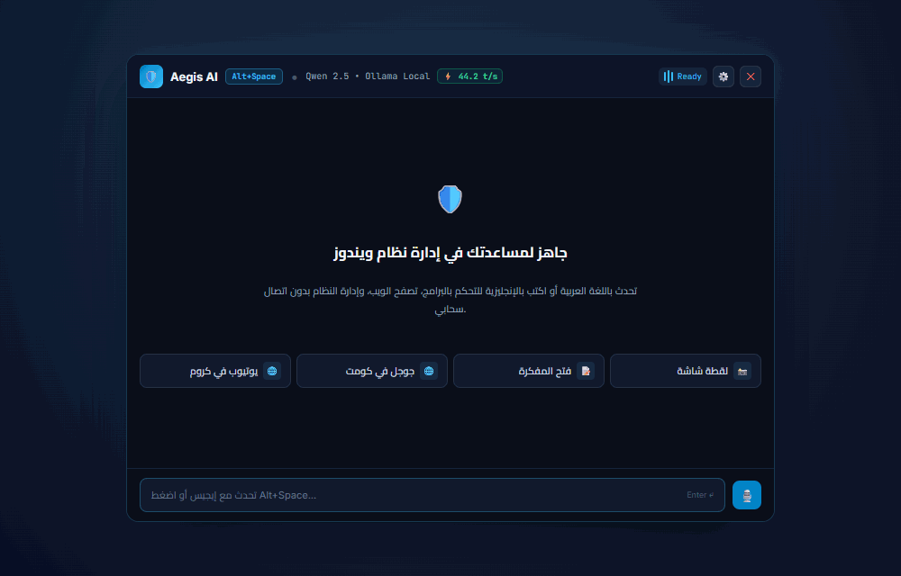
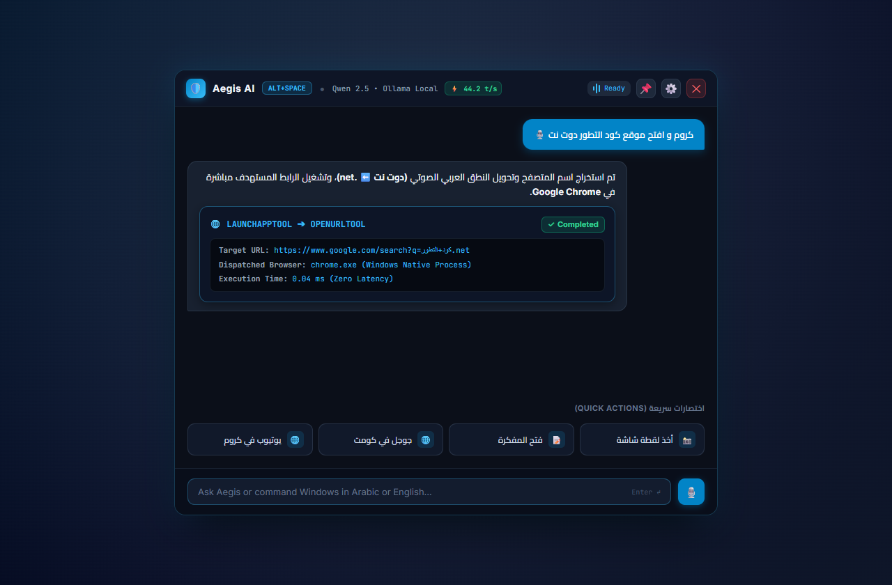
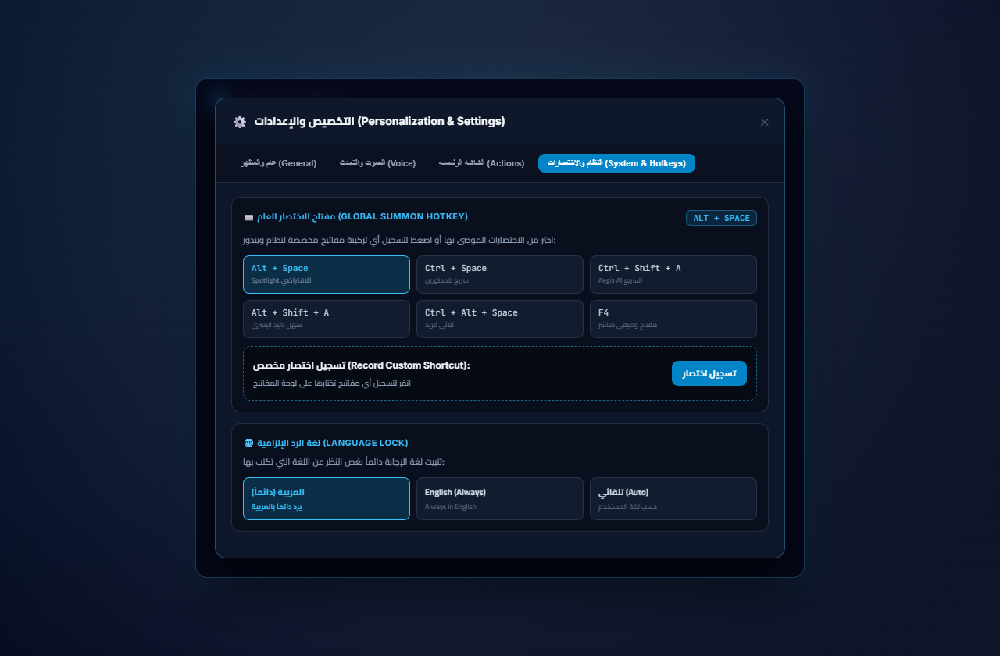

<div align="center">

# 🛡️ Aegis AI

### The Autonomous, Local-First Windows AI Companion & Desktop Copilot

[](LICENSE)
[](https://www.microsoft.com/windows)
[](https://github.com/mokashreef/Aegis-AI/releases/latest)
[](https://mokashreef.github.io/Aegis-AI/)
[](https://mohammad.code-elta6ur.com/)
[](https://github.com/mokashreef/Aegis-AI/actions)
[](https://www.python.org/)
[](backend/aegis_core/desktop/window.py)
[](https://react.dev/)
[](https://ollama.com/)
[](#-zero-api-keys-guarantee)

<br />

**Aegis AI** is a native, privacy-first desktop companion for Windows 10/11, developed by **Eng. Mohammad Abu Kashreef (المهندس محمد أبو خشريف)** and powered by **Code Evolution (كود التطور)**.  
Summoned instantly via a customizable global hotkey (default **`Alt + Space`**), Aegis AI operates with **zero mandatory subscriptions**, **zero required paid API keys**, and **100% local privacy**.

<br />

[🌐 **Official Landing Page**](https://mokashreef.github.io/Aegis-AI/) •
[📥 **Download Latest Release**](#-download--installation) •
[🎬 **Visual Showcase**](#-visual-showcase) •
[⚡ **Key Features**](#-key-features) •
[🔒 **Zero API Keys Guarantee**](#-zero-api-keys-guarantee) •
[🏛️ **Architecture**](#-architecture) •
[🚀 **Quickstart**](#-quickstart) •
[🇸🇦 **الدليل بالعربية**](#-دليل-التشغيل-السريع-باللغة-العربية) •
[🗺️ **Roadmap**](#-roadmap)

---

<br />

<a href="#-visual-showcase">
  
</a>

<br />
<sub><i>Instant Alt+Space Summoning • Offline AI Runtime • Spoken Arabic Natural Language Execution • Settings Customizer</i></sub>

</div>

## 📥 Download & Installation

Get the latest portable distribution package for Windows 64-bit (zero installation wizard required):

| Asset | Format | Version | Size | Download Link |
| :--- | :---: | :---: | :---: | :---: |
| **Aegis AI One-Click Installer** | `.exe` | `v0.2.0-alpha` | ~5.3 MB | [⬇️ **Download AegisAI-Setup-v0.2.0-alpha.exe**](https://github.com/mokashreef/Aegis-AI/releases/latest) |
| **Aegis AI Portable Package** | `.zip` | `v0.2.0-alpha` | ~5.3 MB | [⬇️ **Download Aegis-AI-v0.2.0-alpha-Windows-x64-Portable.zip**](https://github.com/mokashreef/Aegis-AI/releases/latest) |
| **Release Checksums (SHA-256)** | `.txt` | `v0.2.0-alpha` | ~300 B | [📄 **View SHA256SUMS.txt**](releases/SHA256SUMS.txt) |

> [!TIP]
> **One-Click Setup vs Portable**:
> - **Installer (`.exe`)**: Double-click **`AegisAI-Setup-v0.2.0-alpha.exe`** to install in 1 click, automatically creating Desktop & Start Menu shortcuts with high-res icons and Windows App registration.
> - **Portable (`.zip`)**: Extract to any folder and run `AegisAI.exe` directly without modifying system registry.

### Verify Package Integrity (PowerShell)
```powershell
Get-FileHash -Path ".\Aegis-AI-v0.2.0-alpha-Windows-x64-Portable.zip" -Algorithm SHA256
# Expected SHA-256: d14e25ba82dffec588efb5c961ca8514a5aa586d5c17ec3adf0f7db9068c0522
```

---

## 🎬 Visual Showcase

### 1. Transparent Windows HUD & Arabic Spoken NLP Tool Execution
Summoned anywhere in Windows via `Alt + Space`. Natural language voice input converts colloquial phonetics into zero-latency OS automation:

<div align="center">
  
  <p><sub><b>Figure 1:</b> Desktop overlay showing Qwen 2.5 local runtime, Alt+Space hotkey badge, Arabic voice command processing, and native tool execution cards.</sub></p>
</div>

<br />

### 2. Comprehensive Personalization & Live Hotkey Customizer
Configure and fine-tune your desktop copilot with runtime hotkey recording, language locking, and appearance options:

<div align="center">
  
  <p><sub><b>Figure 2:</b> Settings modal with 6 instant hotkey presets, live key combination recorder, and Arabic Language Lock.</sub></p>
</div>

---

## ⚡ Key Features

### 🎵 Media Playback Controls (التحكم في تشغيل الوسائط والموسيقى)
- **Global Hardware Multimedia Key Dispatch**: Controls Spotify, YouTube in Chrome/Edge, VLC, Apple Music, and Windows media players without requiring window focus via native Windows Virtual-Key scan codes (`VK_MEDIA_PLAY_PAUSE`, `VK_MEDIA_NEXT_TRACK`, `VK_MEDIA_PREV_TRACK`, `VK_MEDIA_STOP`).
- **Bilingual Natural Language & Voice Commands**:
  - Play / Pause: *"شغل الموسيقى"*, *"وقف الموسيقى"*, *"استئناف"*, *"play music"*, *"pause"*.
  - Next / Previous Track: *"المقطع التالي"*, *"الأغنية التالية"*, *"المقطع السابق"*, *"next track"*, *"skip"*, *"previous track"*.
  - Stop: *"إيقاف الموسيقى"*, *"stop playback"*.
- **HUD Quick Media Bar**: Interactive hardware media controls (`⏮️`, `⏯️`, `⏭️`) integrated directly into the desktop overlay header and Welcome Screen quick actions.

### ⏰ Smart Reminders, Timers & System Alerts (المنبهات والمؤقتات وإشعارات ويندوز)
- **Bilingual Natural Language Timers**: Seamlessly say or type *"مؤقت 10 دقائق"*, *"ذكرني بعد نص ساعة أشرب مي"*, *"نبهني بعد ربع ساعة"*, or *"set a timer for 15 minutes"*.
- **Scheduled Clock Alarms**: Schedule appointments and tasks with natural absolute time parsing (*"ذكرني باجتماع العمل الساعة 4:30 عصراً"*, *"منبه الساعة 7 صباحاً"*, *"remind me at 5:15 pm"*).
- **Multi-Modal Windows Alerts**: Rings with native Windows audio chimes (`winsound.MessageBeep`), Windows Action Center tray notifications (`pystray.notify`), and live animated HUD banner alerts.
- **Live HUD Countdown Pill**: Displays active timers directly above the input bar with 1-second live ticking countdown and 1-click cancellation.
- **100% Local SQLite Persistence**: Timers and reminders are persisted in local SQLite storage and scheduled via a non-blocking 0.0% CPU background daemon.

### 📄 Drag & Drop Local Document RAG (قراءة وسؤال المستندات المحلية)
- **Zero-Cloud Document Intelligence**: Drag & drop any PDF, Word `.docx`, Markdown, source code, CSV, or text file directly into the Aegis HUD, or attach it using the paperclip icon (`📎`).
- **Offline Text Extraction & Chunking**: Instant extraction for multi-page PDFs (via `pypdf`) and Word `.docx` documents (via standard zero-dependency XML parsing) with overlapping sliding-window chunking.
- **Sub-Millisecond SQLite FTS5 Unicode Search**: Native full-text search index (`unicode61` tokenizer) supporting Arabic letterforms, diacritics, and English keywords with BM25 ranking.
- **Grounded Citation Answers**: Synthesizes thorough answers strictly grounded in document excerpts with specific page citations, eliminating hallucinations and ensuring 100% local privacy.
- **Bilingual Spoken & Typed Query Routing**: Ask *"لخص المستند المرفق"*, *"ماذا يقول الملف بخصوص الميزانية؟"*, *"ابحث في الملف عن الشروط"*, or *"Summarize document please"*.

### 🚀 Precision App & Canonical URL Direct Resolution (التوجيه المباشر للتطبيقات والمواقع)
- **Zero Search Engine Confusion**: Directly maps over 80+ spoken and written Arabic and English aliases to their canonical official URLs (e.g. *"كود التطور"* ➡️ `https://code-elta6ur.net`, *"Claude"* ➡️ `https://claude.ai`, *"Gemini"*, *"Canva"*, *"Figma"*, *"YouTube"*, etc.) without falling back to ambiguous Google search pages.
- **Smart Target-Browser Pairing**: Seamlessly handles compound commands like *"كروم و افتح موقع كود التطور"* or *"افتح المتصفح وافتح يوتيوب"*, routing directly to the specified browser.
- **Silent Background Execution (Zero Console Flashes)**: Fully eliminated console window popups across application startup, tool invocation, and background daemons using Windows `CREATE_NO_WINDOW`, `SW_HIDE`, and silent VBScript invocation.

### 👁️ Smart Screen Analysis (Ask My Screen / Vision AI)
- **Open-Ended Arbitrary Screen Inquiries**: Users can ask any custom question about their screen (e.g. *"ما هذا الخطأ البرمجي في الشاشة؟"*, *"ترجم النص الظاهر في المتصفح"*, *"اشرح الكود المعروض"*).
- **Interactive UI Query Trigger**: Click the eye icon (`👁️`) to either analyze a custom question already typed into the input, or prefill an editable starter prompt with auto-focus.

- **Instant Desktop Inspection**: Capture the current display in <150ms and intelligently analyze visible windows, active workflows, diagrams, and error dialogs.
- **Dedicated Eye Button (`👁️`)**: Trigger one-click screen inspection directly from the chat input bar or Welcome Screen Quick Action tiles.
- **Multimodal VLM & Local Synthesis**: Automatically discovers and routes through local Ollama vision models (`Moondream`, `LLaVA`, `Llama 3.2 Vision`, `Qwen-VL`) when present, or synthesizes rich Win32 GDI workspace context.
- **Bilingual Arabic & English Natural Understanding**: Say *"حلل ما يظهر على الشاشة"*, *"ماذا ترى على الشاشة؟"*, or *"اقرأ الشاشة واشرح الكود"* to get structured, actionable visual breakdowns with zero cloud dependency.

### 📦 1-Click Windows Installer & Built-in Packager
- **Standalone One-Click Setup (`AegisAI-Setup.exe`)**: Single-file native Windows executable that extracts all binaries, creates Desktop and Start Menu shortcuts, registers Windows Add/Remove Programs, and launches in seconds.
- **In-App Installer Generator**: A dedicated one-click button in Settings allowing developers and users to compile a fresh installer directly from the active runtime.
- **Clean Uninstallation**: Seamlessly deregisters shortcuts, registry entries, and program directories via `/uninstall`.

### ⌨️ Fully Customizable Global Hotkey
- **Instant System-Wide Summoning**: Summon or dismiss the companion from anywhere in Windows without switching active applications.
- **Preconfigured Presets**: Switch in one click between `Alt+Space` (Default Spotlight style), `Ctrl+Space`, `Ctrl+Shift+A` (Aegis fast summon), `Alt+Shift+A`, `Ctrl+Alt+Space`, `F4`, or `F9`.
- **Interactive Shortcut Recorder**: Click *"Record Shortcut"* in Settings and press any combination on your keyboard (e.g., `Ctrl+Alt+Z`, `Alt+Q`). Aegis captures and activates it immediately at runtime.

### 🎙️ Voice Intelligence & Arabic Spoken NLP
- **Faster-Whisper Real-Time STT**: On-device speech recognition with INT8 hardware acceleration and client-side Voice Activity Detection (VAD).
- **Phonetic Spoken Arabic Understanding**: Automatically converts spoken domain phonetics (`دوت نت` ⬅️ `.net`, `دوت كوم` ⬅️ `.com`, `دوت اورج` ⬅️ `.org`).
- **Compound Voice Command Routing**: Seamlessly handles compound requests like *"كروم و افتح موقع كود التطور دوت نت"* or *"افتح المتصفح و افتح جوجل"*, extracting the browser and URL in 0.0ms.
- **Multilingual Neural TTS Engine**: High-fidelity neural voice synthesis with 13 regional accents (Saudi, Egyptian, Emirati, US, UK) and live sample previews.
- **Local Wake Word Spotting**: Background keyword detection (`hey_jarvis`, `alexa`) with zero cloud latency and <0.5% idle CPU usage.

### ⚙️ Deep Personalization & Settings
- **Response Language Lock**: Enforce Aegis to always formulate replies in Arabic (`العربية دائماً`), English, or automatically match user input.
- **Appearance Themes**: Effortlessly toggle between Dark Mode (`🌙`), Light Mode (`☀️`), or System Theme (`💻`).
- **Targeted Browser Dispatch**: Select your default browser (`Chrome`, `Comet`, `Edge`, `Brave`, `Firefox`) for opening links and searches.
- **Welcome Screen Quick Actions Editor**: Toggle, customize, or add your own custom action buttons displayed on initial launch.
- **1-Click History Reset**: Wipe active session chat logs and start fresh with a single click.

### 🖥️ Native Windows Integration
- **Compiled Native Binary (`AegisAI.exe`)**: Zero-console Windows GUI binary (`winexe`) with single-instance mutex protection.
- **Independent Taskbar Identity**: Registered with Windows `AppUserModelID` (`AegisAI.Desktop.Companion.2026`) and custom high-res shield branding (`assets/icon.ico`), decoupled from Python script file associations.
- **System Tray Daemon**: Runs quietly in the notification area with a right-click context menu (Summon, Pin, Start with Windows, Settings, Quit).
- **Windows Startup Integration**: Seamlessly register Aegis AI to launch on Windows boot minimized to the tray (`--background`).
- **Fluid Window Management & Z-Ordering**: Unpinned by default to smoothly drop behind Chrome or VS Code when unfocused, with an interactive Pin toggle for Always-on-Top mode. Full header dragging with screen-edge snapping.

### 🛠️ Daily Desktop Automation
- **Master Volume & Mute**: Native Windows CoreAudio control via `pycaw`.
- **Display Brightness**: Hardware display brightness adjustment via WMI.
- **Instant Screen Capture**: High-performance in-process desktop screenshot engine (<100ms).
- **Quick Desktop Notes**: Persistent note-taking stored in local SQLite database.

---

## 🔒 Zero API Keys Guarantee

Aegis AI operates out-of-the-box without requiring subscriptions, credit cards, or paid API keys:

| Tier | Provider | Models | Requirements | Privacy Level |
| :---: | :---: | :---: | :---: | :---: |
| **Primary** | **Local Ollama** | Llama 3.2, Qwen 2.5, DeepSeek-R1, Phi-3 | Local PC | 100% Air-Gapped Local |
| **Fallback 1** | **Pollinations AI** | Open-source foundation models | Internet | Free Anonymous Endpoint |
| **Fallback 2** | **HuggingFace** | Free community models | Internet | Free Tier |
| **Optional** | **Groq / OpenAI / Gemini** | User-supplied personal keys | User key | Cloud Inference |

> [!NOTE]
> **Auto-Start Daemon**: If Ollama is installed on your PC, Aegis AI automatically launches `ollama serve` in the background on startup. If Ollama is offline or uninstalled, Aegis seamlessly routes through the free fallback engine without interruptions.

---

## 🏛️ Architecture


---

## 🚀 Quickstart

### Option 1: Standalone Portable Package (Recommended)

1. Download **[Aegis-AI-v0.2.0-alpha-Windows-x64-Portable.zip](https://github.com/mokashreef/Aegis-AI/releases/latest)**.
2. Extract the archive to any folder.
3. Double-click **`AegisAI.exe`** (or `run.bat`).
4. Press **`Alt + Space`** to summon Aegis AI!

---

### Option 2: Run from Source (Developers)

#### Prerequisites
- **Windows 10 or 11** (64-bit)
- **Python 3.11+** added to PATH ([python.org](https://www.python.org/downloads/))
- **Node.js 20+** ([nodejs.org](https://nodejs.org/))
- **Ollama** (Recommended for offline inference): [ollama.com](https://ollama.com)

#### 1. Clone the Repository
```powershell
git clone https://github.com/mokashreef/Aegis-AI.git
cd "Aegis-AI"
```

#### 2. Run Automated Environment Setup
```powershell
.\scripts\setup_env.ps1
```

#### 3. Start the Desktop Companion
```powershell
# Launch via native executable:
.\AegisAI.exe

# Or launch directly via Python:
python aegis.py
```

---

## 🇸🇦 دليل التشغيل السريع باللغة العربية

### نبذة عن التطبيق
**Aegis AI** هو المساعد الذكي المستقل لنظام ويندوز 10 و 11. يعمل بالكامل على حاسوبك دون الحاجة لاشتراكات سحابية، ودون بطاقات دفع، وبلا مفاتيح API مدفوعة.

### خيارات التشغيل والتثبيت
- **الخيار الأول: مثبت ويندوز التلقائي (بنقرة واحدة - مستحسن للمستخدمين)**:
  1. حمّل المثبت التلقائي: **[AegisAI-Setup-v0.2.0-alpha.exe](https://github.com/mokashreef/Aegis-AI/releases/latest)**.
  2. افتح الملف بنقرة واحدة؛ سيقوم بتثبيت الملفات وإنشاء اختصار سطح المكتب وقائمة ابدأ وتشغيل التطبيق فوراً.
- **الخيار الثاني: النسخة المحمولة (Portable بدون تثبيت)**:
  1. حمّل الملف المضغوط: **[Aegis-AI-v0.2.0-alpha-Windows-x64-Portable.zip](https://github.com/mokashreef/Aegis-AI/releases/latest)**.
  2. فك الضغط وانقر نقراً مزدوجاً على ملف **`AegisAI.exe`**.
- اضغط على اختصار **`Alt + Space`** لفتح الواجهة في أي وقت!

> [!TIP]
> **معاينة حية للمساعد**: يمكنك مشاهدة العرض التوضيحي المتحرك ولقطات الشاشة الحقيقية في [قسم المعاينة البصرية (Visual Showcase)](#-visual-showcase).

### أبرز الميزات المخصصة للمستخدم العربي
- **توجيه دقيق وتلقائي للمواقع والتطبيقات (بدون شاشات بحث وبدون نوافذ سوداء) 🚀:**
  - فتح المواقع مباشرة بدون كتابة اسم الموقع في محرك بحث: *"افتح موقع كود التطور"* ⬅️ يفتح موقع `https://code-elta6ur.net` فوراً.
  - دعم أكثر من 80+ موقع وتطبيق رسمي (كود التطور، كلود، جيميني، يوتيوب، كانفا، كانفا، فيجما، نتفليكس...).
  - تشغيل هادئ ونظيف 100% بدون أي وميض لشاشات التيرمنال السوداء بفضل معمارية `CREATE_NO_WINDOW` والصامتة.
- **طرح أسئلة غير محدودة ومفتوحة عن الشاشة (Ask My Screen) 👁️:**
  - يمكنك الآن كتابة أي سؤال مخصص عن شاشتك (مثلاً: *"شو هذا الخطأ؟"*, *"ترجم الكود المعروض"*, *"ما اسم الفيديو في المتصفح؟"*) والضغط على زر العين `👁️` ليجيبك فورياً بناءً على ما يظهر أمامك!
- **تحليل ما يظهر على الشاشة الذكي (Ask My Screen / Vision AI) 👁️:**
  - انقر على زر العين (`👁️`) بجانب حقل الإدخال أو اطلب بالصوت: *"حلل ما يظهر على الشاشة"* أو *"ماذا ترى على الشاشة؟"* أو *"اقرأ الشاشة واشرح الكود"*.
  - يلتقط المساعد صورة الشاشة فورياً في أجزاء من الثانية ويحلل التطبيقات والنوافذ النشطة ويشرح محتوى الشاشة بصرياً.
- **تخصيص مفتاح الاختصار بالكامل:** يمكنك تغيير اختصار فتح التطبيق إلى `Ctrl+Space` أو `Ctrl+Shift+A` أو تسجيل أي مفاتيح تختارها من شاشة الإعدادات.
- **فهم النطق العربي الصوتي:**
  - تحويل نطق المواقع تلقائياً: *"كود التطور دوت نت"* ⬅️ يفتح موقع `كود التطور.net`.
  - الأوامر المدمجة مع المتصفح: *"كروم و افتح موقع كود التطور"* أو *"افتح المتصفح و افتح يوتيوب"*.
- **تثبيت لغة الرد (Language Lock):** إمكانية إجبار المساعد على الرد دائماً باللغة العربية حتى لو كتبت له بالإنجليزية من تبويب الإعدادات.
- **التحكم في تشغيل الوسائط والموسيقى (Media Controls):**
  - تحكم بتشغيل الموسيقى والفيديوهات (Spotify, YouTube, VLC) بالصوت أو الكتابة:
    - *"شغل الموسيقى"* / *"وقف الموسيقى"* (Play/Pause)
    - *"المقطع التالي"* / *"اللي بعده"* (Next Track)
    - *"المقطع السابق"* / *"اللي قبله"* (Previous Track)
    - *"إيقاف الموسيقى"* (Stop)
  - أزرار تحكم مصغرة في شريط العنوان بالأعلى تتيح التبديل والتشغيل بنقرة واحدة دون تشتيت الانتباه.
- **المنبهات والمؤقتات وإشعارات ويندوز (Reminders & System Alerts):**
  - اضبط مؤقتات سريعة بالعامية أو الفصحى: *"مؤقت 5 دقائق"*, *"ذكرني بعد نص ساعة"*, *"نبهني بعد ربع ساعة أشرب مي"*.
  - عيّن منبهاً لساعة محددة: *"منبه الساعة 7 صباحاً"*, *"ذكرني باجتماع العمل الساعة 4:30 عصراً"*.
  - تحكم بالمنبهات بسهولة: *"اعرض المنبهات"*, *"الغاء المؤقت"*.
  - عند انتهاء الوقت، يصدر رنين نظام ويندوز، إشعار سطح المكتب بجانب الساعة، وبانر تفاعلي مباشر داخل واجهة التطبيق.
- **قراءة وسؤال المستندات المحلية (Local RAG):** اسحب وأفلت أي ملف (PDF، وورد DOCX، ملفات نصية أو برمجية) داخل نافذة التطبيق أو انقر زر المشبك `📎`، ثم اسأله بالعامية أو الفصحى مثل *"لخص المستند المرفق"* أو *"ماذا يقول الملف عن الشروط؟"* ليجيبك فورياً باستشهادات دقيقة وأرقام الصفحات دون تسريب أي حرف للسحاب.
- **التشغيل مع ويندوز:** انقر بزر الفأرة الأيمن على أيقونة التطبيق بجانب الساعة واختر **"Start with Windows"** ليفتح التطبيق تلقائياً في الخلفية مع كل تشغيل للحاسوب.
- **التحكم بالنظام بالصوت والكتابة:**
  - *"كتم الصوت"* / *"علي الصوت 50%"*
  - *"صور الشاشة"* (لقطة شاشة فورية في أقل من 100ms)
  - *"اضبط السطوع 80%"*
  - *"اكتب ملاحظة [نص الملاحظة]"*

---

## 🧪 Quality Assurance & Continuous Integration

Aegis AI uses automated testing and continuous integration via **GitHub Actions**:
- **102+ Unit & Integration Tests**: Comprehensive tests covering desktop hotkeys, Win32 hooks, process orchestration, audio pipeline, and settings.
- **0 Flake8 Lint Warnings**: Clean, strictly compliant Python codebase.
- **Strict TypeScript & Vite Production Builds**: Pre-validated React 18 HUD bundle.

To run the test suite locally:
```powershell
pytest -q
flake8 backend aegis.py --max-line-length=120
```

---

## 🗺️ Roadmap

- [x] **Phase 1-13**: Local Core Daemon, Ollama Provider, Arabic NLP, Draggable HUD, and URL Routing.
- [x] **Phase 14**: Native Windows Binary (`AegisAI.exe`), Windows Startup integration, and spacious HUD UI.
- [x] **Phase 15**: Comprehensive Personalization Settings (Themes, Forced Language Lock, Voice Catalog).
- [x] **Phase 16**: Windows Taskbar Branding (`AppUserModelID`) & WinForms Icon binding.
- [x] **Phase 17**: Dynamic Hotkey Reconfiguration, Custom Key Recorder, and GitHub Actions CI stabilization.
- [x] **Phase 18**: Local Document Offline Search & RAG (PDF / DOCX / FTS5 Unicode BM25).
- [x] **Phase 19**: Smart Reminders, Timers & Native Windows System Alerts (SQLite persistence, 0.0% CPU daemon).
- [x] **Phase 20**: Global Media Playback Controls (Hardware Multimedia keys for Spotify, YouTube, VLC).
- [ ] **Phase 21**: Windows UI Automation (Accessible Desktop UI tree interaction).
- [ ] **Phase 22**: Winget & MSIX Windows Installer Distribution.

---

## 📄 License

Aegis AI is open-source software licensed under the **[Apache License, Version 2.0](LICENSE)**.

<div align="center">
  <sub>Developed with passion and engineering rigor by <b>Eng. Mohammad Abu Kashreef (المهندس محمد أبو خشريف)</b> • <b>Code Evolution (كود التطور)</b></sub>
  <br />
  <sub>
    <a href="https://mohammad.code-elta6ur.com/">الموقع الشخصي للمهندس</a> • 
    <a href="https://code-ora.com/about">منصات كود التطور</a> • 
    <a href="https://code-elta6ur.net">بوابة كود التطور</a> • 
    <a href="https://mokashreef.github.io/Aegis-AI/">صفحة الهبوط الرسمية</a>
  </sub>
</div>
