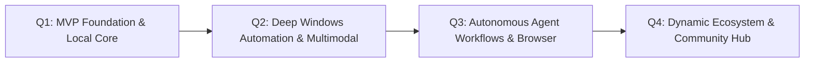

# Aegis AI — 12-Month Product & Engineering Roadmap

This roadmap details the strategic vision and quarterly execution milestones for **Aegis AI** over the next 12 months. Aegis AI is built to be the premier open-source, local-first Windows AI companion—designed for permanence, zero vendor lock-in, and deep operating system integration.

---

## 🎯 Milestone 1: MVP Core Assistant & Windows Companion (Months 1–3)

**Objective**: Deliver a rock-solid, production-grade desktop companion that runs 100% locally with zero paid API keys, binds to global Windows hotkeys, and supports conversational chat, voice interaction, and foundational system tools.

### Key Deliverables:
- [x] **Project Scaffolding & CI/CD**: Clean repository layout, automated GitHub Actions testing across Windows and Linux, flake8 linting, and TypeScript type-checking.
- [x] **Zero-Cost AI Runtime Engine**:
  - Local Ollama orchestrator with automatic model detection (e.g., Llama 3, Qwen 2.5, Phi-3).
  - Resilient fallback chain to free public endpoints (Pollinations AI, HuggingFace Inference, Groq free tier).
  - Unified streaming interface with automatic reconnection and graceful error degradation.
- [x] **Desktop Overlay & Hotkey Architecture**:
  - Tauri-based ultra-lightweight Windows desktop window with transparent overlay and system tray daemon.
  - Global hotkeys (`Alt + Space`, `Win + Space`) with customizable keybinding profiles.
  - React + TypeScript HUD interface with responsive animations, keyboard navigation, and theme customization.
- [x] **Local Memory & Persistence**:
  - SQLite local database for conversations, user preferences, and interaction logs.
  - Context truncation and sliding-window conversational memory manager.
- [x] **Foundational Voice STT / TTS**:
  - Faster-Whisper integration for offline, low-latency speech recognition.
  - Piper TTS integration for fast neural voice synthesis with local ONNX models.
- [x] **Dynamic Plugin & Tool Foundation**:
  - Extensible tool registration protocol (`BaseTool`) with JSON-schema input validation.
  - Baseline desktop tools: application launch/close, clipboard read/write, file system navigation.

---

## 🚀 Milestone 2: Deep Windows Automation & Multimodal Knowledge (Months 4–6)

**Objective**: Transform Aegis AI into an active operating system collaborator capable of reading screens, parsing local files, understanding context, and executing native Windows UI interactions.

### Key Deliverables:
- [ ] **Native Windows UIAutomation Engine**:
  - Integration with Windows Accessibility and UIAutomation APIs to identify controls, buttons, text fields, and menus across running applications.
  - Reliable mouse click and keyboard input simulation with focus safety checks.
  - Window management suite (tile, snap, minimize, restore, focus, multi-monitor coordinates).
- [ ] **Multimodal Screenshot & Vision Reasoning**:
  - Screen grab and region-specific snip analyzer.
  - Local Vision-Language Model support (e.g., LLaVA, Moondream, MiniCPM-V via Ollama).
  - OCR pipeline using Windows Media OCR or Tesseract for instant text extraction from images.
- [ ] **Local Document & Knowledge Base (RAG)**:
  - Local vector database engine (embedded SQLite-vec / ChromaDB).
  - Chunking and ingestion pipeline for PDF, DOCX, TXT, Markdown, and CSV files.
  - Zero-cloud semantic search with local embedding models (e.g., `all-MiniLM-L6-v2`, `bge-small-en`).
- [ ] **Smart Clipboard History & Assistant**:
  - Encrypted, local clipboard monitor with intelligent search, format stripping, and code snippet auto-detection.

---

## 🧠 Milestone 3: Autonomous Agent Workflows & Browser Engine (Months 7–9)

**Objective**: Enable long-running, multi-step problem solving, autonomous research, and headless web task execution.

### Key Deliverables:
- [ ] **ReAct & Plan-and-Solve Agent Engine**:
  - Multi-step reasoning loops with self-reflection, plan generation, and error recovery.
  - Asynchronous background task scheduler with desktop notification updates upon completion.
  - Human-in-the-loop permission gates for destructive or high-risk actions.
- [ ] **Playwright Headless Browser Automation**:
  - Sandboxed Chromium controller for automated research, form filling, and web navigation.
  - Anti-detection optimizations and headless execution for scheduled scraping tasks.
  - Markdown article extractor and web search fallback (using DuckDuckGo / SearXNG public instances).
- [ ] **Voice Wake Word & Continuous Dialogue**:
  - Offline wake word engine (openWakeWord / Porcupine free models) listening for "Hey Aegis".
  - Voice Activity Detection (Silero VAD) for natural interruptions and turn-taking.
- [ ] **Meeting & Audio Summarizer**:
  - Virtual audio loopback recording from microphone and system sound.
  - Automated transcript generation, speaker tagging, and action-item extraction.

---

## 🌐 Milestone 4: Ecosystem, Plugin Store & Fleet Coordination (Months 10–12)

**Objective**: Build a vibrant developer ecosystem, third-party plugin marketplace, and cross-device local synchronization.

### Key Deliverables:
- [ ] **Aegis Plugin Registry & Sandboxing**:
  - Public repository for community plugins with digital signature verification.
  - Micro-process isolation and permission scoping for community extensions.
  - Low-code plugin creation wizard for everyday users.
- [ ] **Local Fleet Sync & Cross-Device Mesh**:
  - Peer-to-peer encrypted synchronization (via Tailscale / WebRTC / local LAN) for memory and notes between laptop and desktop.
  - Zero cloud intermediary sync architecture.
- [ ] **Enterprise & Power User Profiles**:
  - Configurable profiles (Developer, Researcher, Writer, Gamer) with tailored hotkeys and active tool subsets.
  - Offline LLM fine-tuning and LoRA adapter switching for personalized writing styles.
- [ ] **v1.0 Production Release**:
  - Comprehensive third-party security audit.
  - MSIX / Winget package distribution for one-click Windows installation.
  - Complete internationalization (i18n) across English, Arabic, Spanish, German, Japanese, and Chinese.

---

## Evaluation & Progress Tracking

Every milestone corresponds to a designated tracking directory in `docs/milestones/` and associated GitHub Project boards. Releases are tagged and published with full changelog provenance.

