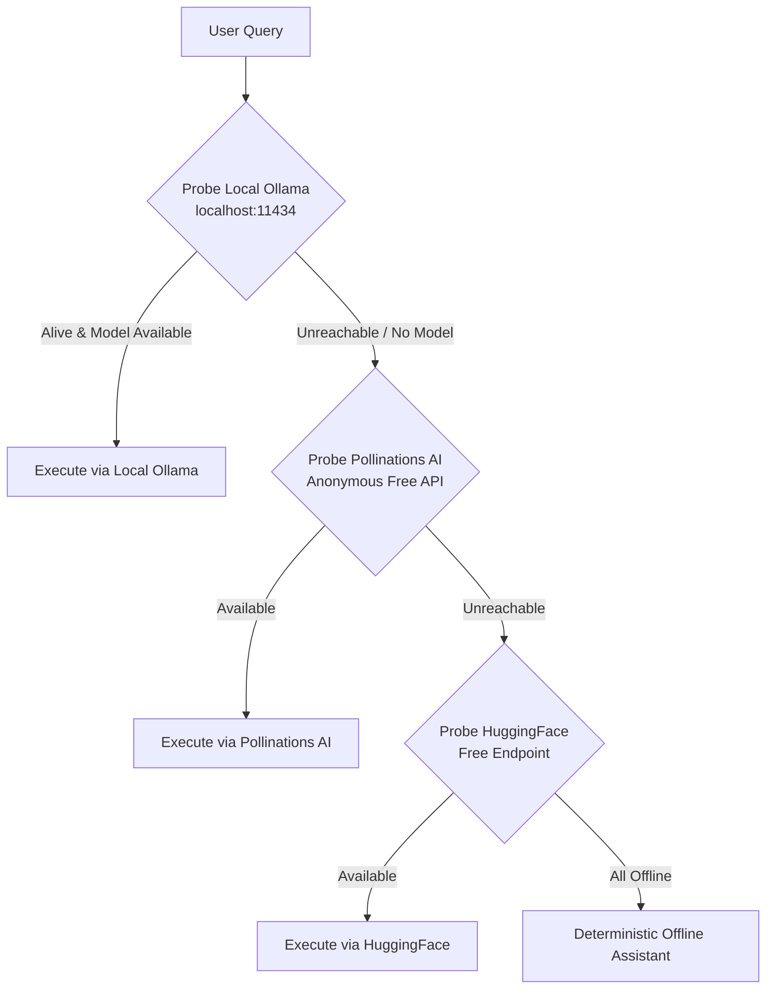

# AI Runtime & Fallback Matrix

Aegis AI is engineered to provide continuous, high-intelligence natural language interaction without ever demanding a paid API key or cloud subscription. This document details the runtime orchestration and automatic fallback mechanisms.

---

## Provider Hierarchy

---

## 1. Primary Engine: Ollama
- **Endpoint**: `http://localhost:11434/api/generate` and `http://localhost:11434/api/chat`
- **Supported Models**: `llama3.2`, `llama3.1`, `qwen2.5`, `mistral`, `phi3`, `gemma2`
- **Streaming**: Native newline-delimited JSON (NDJSON) tokens.
- **Latency**: Local GPU/CPU dependent (typically 20–70 tokens/sec on modern PCs).
- **Privacy**: 100% air-gapped, zero data leaves the local machine.

## 2. Fallback Engine 1: Pollinations AI
- **Endpoint**: `https://text.pollinations.ai/`
- **Authentication**: None (Open Anonymous Tier).
- **Payload Format**: Standard JSON payload (`{"messages": [...], "model": "openai"}`).
- **Use Case**: Transparent failover when the user has not yet installed or started Ollama.

## 3. Fallback Engine 2: HuggingFace Inference API
- **Endpoint**: `https://api-inference.huggingface.co/models/...`
- **Authentication**: Free public tier or optional user token.
- **Model Family**: Mistral-7B-Instruct, Qwen-2.5-Coder.

## 4. Fallback Engine 3: Deterministic Offline Safety Mode
- In the catastrophic event of zero local LLM and zero network connectivity, Aegis AI continues running:
  - Direct keyword-based desktop automation (e.g., "open notepad", "close calc", "get clipboard").
  - System diagnostics and helpful troubleshooting instructions to guide the user in starting Ollama.
